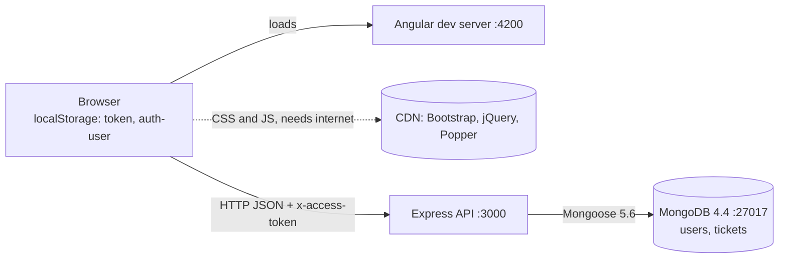

# Component map

**Living document** — what runs, where, and how the pieces talk. Update it in the same PR as any
change to a port, URL, storage key, response shape, or external dependency
([documentation.md](../../rules/documentation.md)). Code structure is in
[layer-map.md](layer-map.md); vocabulary and rules are in [domain-model.md](domain-model.md).

## Runtime components

| Component | Tech | Address | Started by |
|---|---|---|---|
| **Angular SPA** | `clientApp/`, Angular 8 dev server (webpack 4) | http://localhost:4200 | `npm start` in `clientApp/`, or the `ng serve` task that the VS Code *Client* config runs |
| **Express API** | `server/`, `node bin/www` | http://127.0.0.1:3000 (`$PORT`) | VS Code *Server: Express API*, or `node bin/www` |
| **MongoDB 4.4** | Windows service `MongoDB`, starts automatically | 127.0.0.1:27017, database `ticketingApplication`, collections `users` and `tickets` | the service itself |
| **CDN assets** | Bootstrap CSS+JS 4.1.1, jQuery 3.3.1 slim, Popper 1.14.3, each with an SRI hash | stackpath / jquery / cdnjs | the browser, from `clientApp/src/index.html` |
| **Browser storage** | `localStorage` keys `token`, `auth-user` | the user's browser | `login.component.ts` |

There is no reverse proxy, container, cache, queue, email, file storage, third-party API, auth
provider, or CI pipeline. Adding any of these is **Ask First** ([boundaries.md](../../rules/boundaries.md)).

## Screens (Angular)

| Route | Screen | Guard | Calls (`AuthService`) |
|---|---|---|---|
| `/` | redirects to `/login` | — | — |
| `/login` | `login/` | — | `loginUser` |
| `/register` | `register/` | — | `registerUser` |
| `/tickets` | `tickets/` — list, and the create-ticket form | `AuthGuard` | `allTickets`, `allUsers`, `createTicket` |
| `/myTickets` | `my-tickets/` | `AuthGuard` | `myTickets` |
| `/ticketView?selectedTicket=<id>` | `ticket-view/` — view, edit, delete | `AuthGuard` | `ticketView`, `updateTicket`, `deleteTicket` |
| (nav bar) | `app.component` | — | `LoggedIn`, `logoutUser` |

`AuthGuard` only checks that a `token` key **exists** — not that it is valid or unexpired. When the
token is rejected, only `tickets/` and `my-tickets/` redirect to `/login` (on 401/403); `ticket-view/`
just logs the error.

## SPA → API contract

Base URL `http://127.0.0.1:3000`, hard-coded in `clientApp/src/app/auth.service.ts`. Bodies and
responses are JSON. `cors()` is open to every origin. Every request carries `x-access-token`, added
by `token-interceptor.service.ts` (empty string when logged out). Tokens last **50 minutes**.

| Operation | `AuthService` method | Request | Success | Failure |
|---|---|---|---|---|
| Log in | `loginUser` | `POST /login` `{username, password}` | 200 `{success, message, token, user:{_id, type, username, password}}` | 401 `{success:false, message:"Invalid Username"}` or `" Invalid password. "` |
| Register | `registerUser` | `POST /user/create` — User fields | 201 `{message:"Created Successfully", result}` | validation → **200** array; duplicate username / save error → **304** |
| All tickets | `allTickets` | `GET /ticket/` | 200 array | 404 `{message}` |
| My tickets | `myTickets` | `GET /user/:id/tickets` | 200 array | 404 `{message}` |
| One ticket | `ticketView` | `GET /ticket/:id` | 200 object | 404 `{message}` |
| Create ticket | `createTicket` | `POST /ticket/create` — Ticket fields | 201 `{message:"Created Successfully", result}` | validation → **200** array; save error → **304** |
| Update ticket | `updateTicket` | `PATCH /ticket/:id/update` — Ticket fields | 200 `{message:"Successfully Updated", result}` — `result` is the document **before** the update | validation → **200** array; not found → **304** |
| Delete ticket | `deleteTicket` | `DELETE /ticket/:id/delete` | 200 `{message:"Deleted Successfully", result}` | **403** unless Supervisor; not found → **304** |
| All users | `allUsers` | `GET /user/` | 200 array — fills the assignee dropdown | — |
| *(none)* | — | `GET /user/:id` · `PATCH /user/:id/update` · `DELETE /user/:id/delete` | — | **API only: no screen or `AuthService` method calls them** |

**Conventions that surprise people:**

- **Validation errors come back as HTTP 200** with an array of `indicative` errors
  `[{message, field, validation}]`. Screens detect failure by reading `res[0].message`, and success by
  comparing `res.message` to an exact string (`"Created Successfully"`, `"Successfully Updated"`). Don't
  rely on the status code alone, and don't reword those messages without updating the client.
- **A failed write returns 304**, which browsers treat as "not modified". Angular surfaces it as an
  error, and `register.component.ts` maps it to "Username already exist".
- **Auth failures are 403** (`{success:false, message:"Unauthorised"}` with no token, `"Unauthorised User"`
  for a bad/expired token or the wrong role), not 401. The 401s above are login only.
- **Ticket responses embed whole User documents** — `.populate('assignee submitter')` has no field
  selection — so every ticket carries its users' **passwords**. `GET /user/` and the login response
  return them too. Deferred in [MVP-SCOPE.md](../../../MVP-SCOPE.md); treat it as a leak, not a feature,
  when you touch these responses.

## API → MongoDB

| Aspect | Today |
|---|---|
| Client | Mongoose 5.6.11 over driver 3.2.7, connected once in `app.js` with no options, so startup prints two deprecation warnings |
| URL | `mongodb://127.0.0.1:27017/ticketingApplication`, hard-coded in `app.js` (and passed on the command line to `populateDB.js`) |
| Failure mode | a connection error is only logged (`db.on('error', …)`); the server keeps listening |
| Server version | **MongoDB 4.4.** Don't move to a newer server without upgrading Mongoose first |
| Seed | `server/populateDB.js` — 2 users, 2 tickets; fails if run twice (unique `username`) |

## Browser storage contract

| Key | Written by | Read by | Content |
|---|---|---|---|
| `token` | `login.component.ts` | `AuthService.getToken` (interceptor, `AuthGuard`) | the JWT |
| `auth-user` | `login.component.ts` | `AuthService.setUrl`; `tickets/`, `my-tickets/`, `ticket-view/` | `JSON.stringify` of the login response's `user` — **includes the plain-text password**. Role and id are read by fixed string offsets: `.substring(42,47)` and `.substring(8,32)` (layer-map § Client) |

**Logout removes only `token`.** `auth-user` stays in `localStorage` afterwards, password included.

## Secrets and configuration

| Setting | Where | Value |
|---|---|---|
| JWT signing secret | `authentication.js` and `middleware/login.js` | the literal `'secret'` (three times: both files and `server/test/authentication.test.js` — change all or none) |
| Token lifetime | `middleware/login.js` | `50m` |
| API port | `bin/www` | `$PORT`, else 3000 |
| MongoDB URL, API base URL | `app.js`, `auth.service.ts` | hard-coded; `clientApp/src/environments/*.ts` exist but hold no URLs |

There is no `.env` file, so nothing here is configurable without editing code.

## Local development tooling

| Piece | Where | Note |
|---|---|---|
| VS Code debug configs | `.vscode/launch.json`, `.vscode/tasks.json` | **Full Stack: Server + Client**; both pinned to Node 10.24.1 |
| Node version | nvm-windows | **10.24.1** for everything; Node 24 only for harness scripts (CLAUDE.md) |
| Agent harness | `.claude/`, `harness.config.json` | hooks need `jq` on PATH |
