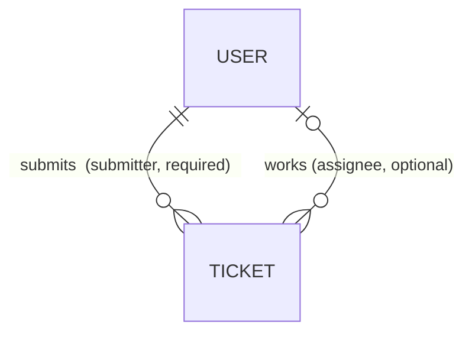

# Domain model — Ticketing (as built)

**Living document** — the vocabulary and rules of the domain *as the code implements them today*.
Update it in the same PR as any change to a model, a state, or a role
([documentation.md](../../rules/documentation.md)).

> **Provenance.** Derived from the code and git history, **not** from a stakeholder workshop. It
> records the terms the code and UI use today. Where the product owner has not confirmed a meaning,
> the item is marked **❓** — treat it as unconfirmed. `/domain ticketing` is the interview workshop
> that would validate this; nobody has run it.
>
> **DDD is not adopted** (CLAUDE.md § *Not adopted yet*). The code has no aggregates, value objects,
> or domain events, and this document does not invent them. "Entity" below means a Mongoose model.

## Bounded context

One: **Ticketing** — the whole application. It has two persisted entities, **User** and **Ticket**,
in `server/models/` (MongoDB collections `users` and `tickets`). Nothing integrates with another
system, so there are no context boundaries or anti-corruption layers to record.

A Ticket references its Users **by id** and the API populates them on read
(`.populate('assignee submitter')`, `ticketController.js`). There are no embedded sub-documents.

## Entities

### User — `server/models/user.js`

| Field | Type | Required | Rules |
|---|---|---|---|
| `first_name`, `last_name` | String | ✅ | |
| `phone` | String | ✅ | |
| `type` | String | ✅ | `Supervisor` or `Agent` — this is the **role** (see glossary) |
| `username` | String | ✅ | **unique** (index). Shown in the UI as the person's name |
| `password` | String | ✅ | 4–40 chars on create/update. Stored in plain text (MVP-SCOPE § Deferred) |
| `date_of_birth` | Date | | must be a date if given |
| `email` | String | | must be a valid email if given |

### Ticket — `server/models/ticket.js`

| Field | Type | Required | Rules |
|---|---|---|---|
| `subject`, `description` | String | ✅ | |
| `created_date`, `due_date` | Date | ✅ | **entered by the user** on the form; the server does not stamp them. Nothing checks that `due_date ≥ created_date` |
| `ticket_state` | String | ✅ | `Open` · `Progressing` · `Done` · `Closed` |
| `submitter` | → User | ✅ | the logged-in user who created it; the **client** fills it from `localStorage` |
| `assignee` | → User | | who works the ticket; may be empty |
| `requester` | String | ✅ | the person who raised the issue, identified by **phone number**; not a User, and free text (not validated as a phone) |

Validation lives in two places that must agree: the Mongoose schema (persisted shape) and the
`indicative` rules in each controller (request shape). The controller rules run first.

## Ticket states

| State | Meaning ❓ (inferred from the name) | Offered in the UI to |
|---|---|---|
| `Open` | new, not started — the default in the create form | everyone |
| `Progressing` | being worked | everyone |
| `Done` | work finished | everyone |
| `Closed` | finalised | **Supervisor only**; hidden from Agents in lists |

**There are no enforced transitions.** `PATCH /ticket/:id/update` accepts any valid state from any
valid token, so any state can follow any other. The "Supervisor only" and "hidden from Agents" rules
exist only in the browser — see [layer-map.md](layer-map.md) § *Where business rules live*.

## Roles and what the API lets them do

| Operation | No token | Agent | Supervisor |
|---|---|---|---|
| Log in · register (`POST /login`, `POST /user/create`) | ✅ | ✅ | ✅ |
| Read tickets and users · create a ticket · update **any** ticket · read "my tickets" | ❌ 403 | ✅ | ✅ |
| Update **any** user, including its `type` and `password` (`PATCH /user/:id/update`) | ❌ 403 | ✅ | ✅ |
| Delete a ticket · delete a user | ❌ 403 | ❌ 403 | ✅ |

The API checks the **role only** (`authentication.authorization`), never ownership: any valid token
may edit any ticket or user. Anyone can register as a Supervisor, because `type` comes from the
request body. All of this is recorded as deferred in [MVP-SCOPE.md](../../../MVP-SCOPE.md).

## Invariants the code actually guarantees

| Invariant | Enforced by |
|---|---|
| Usernames are unique | unique index on `users.username` (a duplicate fails the save) |
| `type` is `Supervisor` or `Agent`; `ticket_state` is one of the four states | schema `enum` **and** `indicative` `in:` rule |
| A ticket always has a subject, description, both dates, a state, a submitter, and a requester | schema `required` **and** `indicative` `required` |
| Deleting a user clears `assignee` on every ticket assigned to them | `userController.user_delete_post` → `middleware/user.js` (`ticketsOfUser`, `deleteUserFromTicket`) |
| Only a Supervisor token can delete | `authorization(supervisor)` on the two `DELETE` routes |

**Not guaranteed** (do not assume any of these):

- `submitter` / `assignee` point at a real user. Deleting a user clears `assignee` on their tickets
  but **does not touch `submitter`**, so tickets they logged keep a dangling id
- `due_date ≥ created_date`, or either date being "today"
- a legal state transition, or that only Supervisors set `Closed` (client-only)
- an assignee on every ticket. The screens dereference `ticket.assignee._id` and
  `ticket.submitter._id` / `.username` without a guard, so a ticket with no assignee, or whose
  submitter was deleted, breaks the ticket-view screen (read from `ticket-view.component.ts` and its template)

## Ubiquitous language

Use these terms in code, tests, and docs. **Code name** is what appears in source; use it exactly.

| Term | Meaning | Code name · UI label |
|---|---|---|
| **Ticket** | one unit of support work | `Ticket` · "Ticket(s)" |
| **Subject** | the ticket's short title | `subject` |
| **Description** | the ticket's free-text detail | `description` |
| **Requester** | the outside person who raised the issue, known only by phone number. Not a User | `requester` · "Requester Phone" |
| **Submitter** | the User who logged the ticket | `submitter` · "Submitted by" |
| **Assignee** | the User responsible for working the ticket | `assignee` · "Assigned to" |
| **My Tickets** | tickets whose **assignee** is the logged-in user — *not* the ones they submitted | `GET /user/:id/tickets`, route `/myTickets` · "My Tickets" |
| **Ticket state** | where the ticket is in its life — see *Ticket states* | `ticket_state` |
| **Created date / Due date** | calendar dates typed in by the user | `created_date`, `due_date` · "Created on", "Due date" |
| **User** | a person who can log in | `User` |
| **Role** | `Supervisor` or `Agent`. Stored as `User.type` and as the `type` claim in the token. Say *role* in prose and UI copy, `type` in code | `type` |
| **Supervisor** | the role that may delete tickets and users and set `Closed` | `'Supervisor'` |
| **Agent** | the role that works tickets; may not delete, may not see or set `Closed` (UI) | `'Agent'` |
| **Username** | the unique login name; the UI shows it wherever a person is named | `username` |
| **Token** | the JWT from login — 50 minutes, header `x-access-token`, payload `{username, type}` | `token` |
| **Register / Login / Logout** | create a User yourself · obtain a token · discard the token (browser only) | `/register`, `/login` |

## Events and value objects

None. `ticket_state` and `type` are plain strings guarded by an `enum`. If either gains behaviour
(transition rules, permissions) that is the point to promote it to a real type and revisit
[ddd.md](../../rules/ddd.md).

## Leftovers — in the code, not in the domain

Do not treat these as domain concepts:

- `url` virtuals on both models return `/catalog/user/<id>` and `/catalog/ticket/<id>` — from the Express
  tutorial this project grew out of. No such routes exist.
- `age` (User) and `duration` (Ticket) virtuals — nothing reads them. `age` would throw for a user with no
  `date_of_birth`.
- `resources` in the ticket query projections — there is no such field.

## Open questions ❓

| # | Question | Today |
|---|---|---|
| 1 | Who may **see** `Closed` tickets? Commit `4980d29` says only Agents; the code hides them from Agents | Code wins until decided — MVP-SCOPE § Open questions |
| 2 | What does each state mean, and which transitions are legal? | Anything goes |
| 3 | Should an Agent be able to edit a ticket they are not assigned to, or any user? | Yes, today |
| 4 | Should `submitter` come from the token instead of the browser? | Browser-supplied |
| 5 | What happens to tickets *submitted* by a deleted user? | Dangling `submitter` |
| 6 | Is `requester` always a phone number? | Unvalidated free text |
